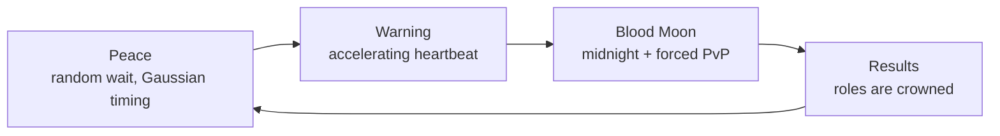

<div align="center">


# ThePurge

**A blood moon survival-horror event for Paper servers.**
Random timing. Permanent midnight. Forced PvP. Nobody knows who to fear.

[](https://modrinth.com/plugin/thepurgeconcept)
[](https://modrinth.com/plugin/thepurgeconcept)
[](https://papermc.io/)
[](https://github.com/FrndlyMoon/ThePurge)
[](LICENSE)

[Download on Modrinth](https://modrinth.com/plugin/thepurgeconcept) ·
[Report a Bug](https://github.com/FrndlyMoon/ThePurge/issues) ·
[Changelog](https://modrinth.com/plugin/thepurgeconcept/changelog)

</div>

---

## Overview

Most days on your server are peaceful. Then the air goes still, a heartbeat starts to thud in the distance, and it speeds up. When it reaches its peak, the **Blood Moon** rises.

For the length of the event the world is locked in **permanent midnight**, **PvP is forced on for everyone**, and every player glows with a random-colored particle trail. Death messages hide the killer's name behind scribbled text, so you never know who got you. When the purge ends, the plugin looks at what actually happened and crowns three roles based on real performance.

ThePurge runs on its own schedule with no admin needed, and almost everything about it is configurable.

<div align="center">
  
</div>
---

## How It Works



| Phase | What happens |
|-------|--------------|
| **Peace** | Normal survival. The time until the next purge is picked from a Gaussian (bell-curve) distribution, so it feels unpredictable but not completely random. |
| **Warning** | A heartbeat sound starts and gets faster as the Blood Moon approaches. |
| **Blood Moon** | Time is locked to midnight, PvP is forced on, players get glowing particle trails, blood-moon dust fills the sky, role effects apply, and a boss bar counts down the remaining time. |
| **Results** | The purge ends and the plugin crowns the Butcher, the Innocent and the Prey based on what happened. |

---

## Roles

Roles are earned through performance, not handed out at random.

| Role | How you earn it | Potion effect |
|------|-----------------|---------------|
| **The Butcher** | Most kills | Strength |
| **The Innocent** | Survived the longest without killing | Invisibility |
| **The Prey** | Died the most | Weakness |

All effects are configurable. Any valid Bukkit `PotionEffectType` is supported.

---

## Features

- **Random purge timing:** Gaussian distribution with configurable min, max, mean and standard deviation
- **Warning phase:** configurable heartbeat audio that accelerates toward the event
- **Permanent midnight:** time of day is locked while the purge is active
- **Forced PvP:** turned on at the start of the purge and restored afterwards
- **Boss bar:** configurable title and color, showing the remaining time
- **Scoreboard teams:** prefixes, colors and collision rules per role
- **Role-based potion effects:** supports any `PotionEffectType`
- **Particle trails:** a random color for each player, plus blood-moon dust above every player
- **Anonymous deaths:** the killer's name is obfuscated in death messages during the purge
- **Locator bar management:** off during peace, on during the purge
- **Admin command suite:** full control and a help menu

---

## Installation

**Requirements**

- A [Paper](https://papermc.io/) server (or a Paper fork)
- Minecraft: Java Edition `1.21.6` to `1.21.11`, `26.1.x` or `26.2`
- A Java version that matches your server's Minecraft version (see the [Paper docs](https://docs.papermc.io/))

**Steps**

1. Download the latest `.jar` from [Modrinth](https://modrinth.com/plugin/thepurgeconcept) or the GitHub Releases page.
2. Drop it into your server's `plugins/` folder.
3. Restart the server. A `config.yml` is generated in `plugins/ThePurge/`.
4. Adjust the config to taste and run `/purge reload`.

> [!NOTE]
> Spigot and Bukkit are not officially supported. The plugin targets Paper APIs.

---

## Commands

All commands are **OP only**.

| Command | Description |
|---------|-------------|
| `/purge start` | Starts a purge immediately |
| `/purge stop` | Ends the current purge |
| `/purge status` | Shows the current phase and timing |
| `/purge roles` | Shows the current role standings |
| `/purge reset` | Resets purge state and stats |
| `/purge reload` | Reloads the configuration |
| `/purge testrole <role> [player]` | Applies a role's effects for testing |
| `/purge help` | Shows the help menu |

---

## Configuration

Everything is controlled from `plugins/ThePurge/config.yml`. You can tune:

| Area | What you can change |
|------|---------------------|
| **Timing** | Min, max, mean and standard deviation of the Gaussian cycle |
| **Warning phase** | Length and heartbeat audio behavior |
| **Boss bar** | Title and color |
| **Teams** | Prefixes, colors and collision rules |
| **Role effects** | Which potion effects each role gets, and their strength |
| **Particles** | Trail and blood-moon dust behavior |

---

## Building from Source

You need JDK and [Maven](https://maven.apache.org/) installed.

```bash
git clone https://github.com/FrndlyMoon/ThePurge.git
cd ThePurge
mvn clean package
```

The compiled jar will be in `target/`.

---

## Contributing

Bug reports, suggestions and pull requests are welcome.

1. Open an [issue](https://github.com/FrndlyMoon/ThePurge/issues) to discuss what you'd like to change.
2. Fork the repo and create a branch (`feature/your-idea`).
3. Open a pull request with a clear description.

---

## Credits

ThePurge is developed by the **FrndlyMoon** team.

| Developer |
|-----------|
| [**LwkMoon**](https://github.com/LwkMoon) | 
| [**FrndlyFrags**](https://github.com/FrndlyFrags) | 

---

## License

Released under the [Apache License 2.0](LICENSE).

*ThePurge is an independent project. It is not an official Minecraft product and is not approved by or associated with Mojang or Microsoft.*
